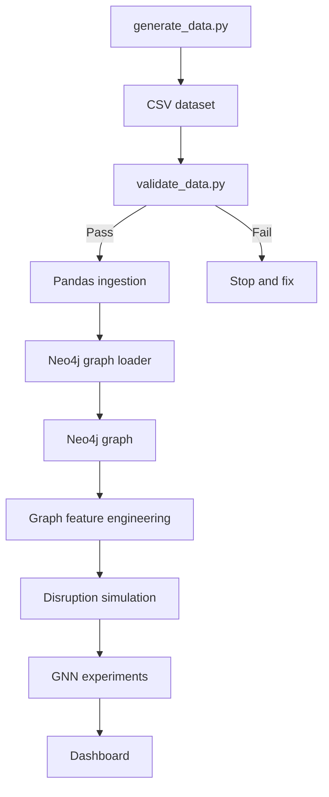

# AtmoGraph — Synthetic Prototype Starter

AtmoGraph explores how disruptions may propagate through interconnected supply-chain industries, ports, and shipping routes.

> **Data notice:** The included CSVs are synthetic and illustrative. They are not real trade flows, port records, shipping routes, or verified disruption events.

## Included prototype data
- 5 countries
- 50 country-specific industry nodes (10 categories per country)
- Rule-based directed supply links
- 5 illustrative ports and 8 shipping-route nodes
- Industry-to-port links
- 10 synthetic disruption events

## Folder structure
```text
AtmoGraph/
├── README.md
├── requirements.txt
├── .env.example
├── data/
│   ├── raw/
│   ├── processed/
│   └── synthetic/  # shared prototype CSVs
├── scripts/
│   ├── generate_data.py
│   ├── validate_data.py
│   └── load_neo4j.py
├── src/
│   ├── ingestion/readers.py
│   └── graph/{schema.py,builder.py}
├── docs/
│   ├── architecture.md
│   ├── graph_schema.md
│   └── data_dictionary.md
├── tests/
└── notebooks/
```

## Setup
Python 3.10+ recommended.
```bash
python -m venv .venv
```
Windows PowerShell:
```powershell
.venv\Scripts\Activate.ps1
```
macOS/Linux:
```bash
source .venv/bin/activate
```
Install:
```bash
pip install -r requirements.txt
```

## 1. Generate CSV files
Run from the repository root:
```bash
python scripts/generate_data.py
```
Default random seed is `42`. Same script version, seed, and configuration reproduce the same dataset.
```bash
python scripts/generate_data.py --seed 42
```

## 2. Validate CSV files
```bash
python scripts/validate_data.py
```
Checks required columns, unique IDs, foreign-key references, and basic value/date ranges. If validation fails, fix the generator/data and do not load the graph.

## 3. Load into Neo4j
1. Start a Neo4j database.
2. Copy `.env.example` to `.env` and fill in connection details.
3. Run:
```bash
python scripts/load_neo4j.py
```
The loader validates again before loading and uses `MERGE` with stable IDs. It creates the graph; it does not run ripple-effect prediction.

## Workflow


## Team rules
- Treat the committed `data/synthetic/` files and `docs/data_dictionary.md` as the shared data contract.
- Do not manually edit generated CSV files.
- Coordinate schema changes before merging to the main branch.
- Keep `.env` private; never commit credentials.
- The first version is a prototype. Define prediction targets and evaluation before GNN training.
