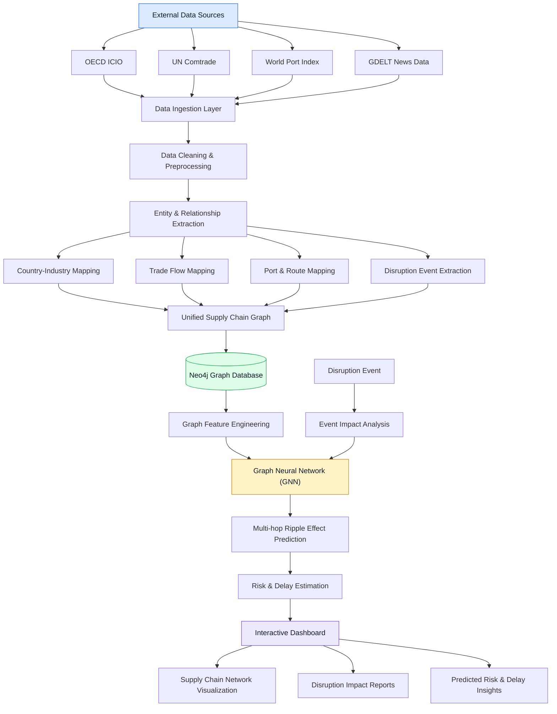

<h1 align="center">🌐 ATMOGRAPH</h1>
<h2 align="center">SUPPLY CHAIN RIPPLE EFFECT</h2>

**Visualizing Global Supply Chain Disruptions Through Graph-Based Intelligence.**

AtmoGraph is a graph-based neural network project designed to track and analyze disruptions across global supply chain networks. It explores how a disruption in one node can create ripple effects across interconnected suppliers, manufacturers, and distributors.

###Technology Stack
- **Frontend:** React.js
- **Visualization:** D3.js
- **Backend:** Python
- **Database:** Neo4j
- **Query Language:** Cypher

### Key Objective
To understand supply chain dependencies, identify disruption propagation, and visualize the ripple effect across interconnected networks.

###Vision
Building smarter, more connected, and resilient supply chain networks through graph-based intelligence.

## Project Architecture

